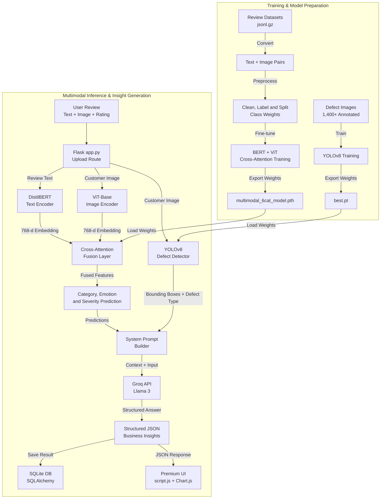

<div align="center">

# 🔍 SYNTRIQ

### Multimodal Product Review Intelligence Platform

**Read what customers write. See what customers show. Understand what it means for the business.**

[](https://www.python.org/)
[](https://flask.palletsprojects.com/)
[](https://pytorch.org/)
[](https://huggingface.co/docs/transformers)
[](https://docs.ultralytics.com/)
[-F55036)](https://groq.com/)
[](#-cloud-deployment-aws-ec2)

[🎥 Demo](#-demo-video) · [🏗️ Architecture](#-architecture--data-flow) · [📊 Results](#-results) · [🗂️ Datasets](#-datasets) · [🚀 Quick Start](#-quick-start) · [☁️ Deployment](#-cloud-deployment-aws-ec2)

</div>

---

## 📑 Table of Contents

1. [Overview](#-overview)
2. [Demo Video](#-demo-video)
3. [Key Features](#-key-features)
4. [Architecture & Data Flow](#-architecture--data-flow)
5. [Results](#-results)
6. [Tech Stack](#-tech-stack)
7. [Project Structure](#-project-structure)
8. [Datasets](#-datasets)
9. [Quick Start](#-quick-start)
10. [Cloud Deployment (AWS EC2)](#-cloud-deployment-aws-ec2)
11. [Roadmap](#-roadmap)
12. [Author](#-author)

---

## 📌 Overview

**SYNTRIQ** is an end-to-end multimodal AI system for e-commerce teams. Traditional review analytics stop at *positive / negative*. SYNTRIQ jointly analyses the **review text**, the **customer-uploaded photo** and the **star rating**, then answers the questions product managers actually care about:

- 🛠️ Is there a **physical defect**, and where exactly is it?
- 😤 What is the customer's **emotion** and **intent**?
- 🚨 How **severe** is the issue?
- 💡 What should the business **do about it**?

Model predictions are passed to **Llama 3 (via Groq)**, which returns structured JSON insights that feed the dashboard and exportable reports.

---

## 🎥 Demo Video

<div align="center">

[](Demo/SYNTRIQ_Demo.mp4)

**▶️ Click the image to watch the full walkthrough (about 4 minutes)**

</div>

---

## ✨ Key Features

| Feature | Description |
|---|---|
| 🔗 **Multimodal Fusion** | Cross-attention fuses **DistilBERT** text embeddings with **ViT** image embeddings, so written claims are checked against visual evidence |
| 🎯 **Custom Defect Detection** | **YOLOv8** trained on 1,400+ images locates cracks, chips and scratches with bounding boxes |
| 🧠 **LLM Reasoning** | Groq-hosted Llama 3 extracts aspects, emotions and intents, and recommends business actions as structured JSON |
| 📈 **Live Dashboard** | Flask web app with real-time SQLite updates, review search and Chart.js analytics |
| 📄 **One-click Reports** | Export AI summaries as text or CSV |
| ☁️ **Cloud Deployed** | Hosted on AWS EC2 and served with Gunicorn |

---

## 🏗️ Architecture & Data Flow



**Pipeline summary**

1. **Input:** review text, customer image and star rating.
2. **Text encoder:** fine-tuned `distilbert-base-uncased` produces 768-d embeddings.
3. **Vision encoder:** `google/vit-base-patch16-224-in21k` produces 768-d image embeddings.
4. **Fusion:** a `MultiheadAttention` layer lets the text query the image, aligning what the customer *wrote* with what the photo *shows*.
5. **Defect detection:** custom YOLOv8 pinpoints physical damage in the image.
6. **LLM reasoning:** predictions go to Llama 3, which returns a structured JSON business summary.

---

## 📊 Results

| Model | Accuracy | Macro F1 |
|---|:---:|:---:|
| Text only (DistilBERT baseline) | 84.4% | n/a |
| Image only (ViT baseline) | 77.3% | n/a |
| **Multimodal (Cross-Attention)** | **91.0%** | **0.89** |

Fusing both modalities improves accuracy by **6.6 points** over the best single-modality baseline. Class weights were used to handle severe dataset imbalance.

---

## 🛠️ Tech Stack

| Layer | Technologies |
|---|---|
| **Backend** | Python, Flask, Gunicorn, SQLite (SQLAlchemy) |
| **Deep Learning** | PyTorch, Hugging Face Transformers (DistilBERT, ViT) |
| **Computer Vision** | YOLOv8 (Ultralytics), OpenAI CLIP |
| **LLM** | Groq API (Llama 3) |
| **Frontend** | HTML5, CSS3, Vanilla JS, Chart.js |
| **Cloud** | AWS EC2 (Ubuntu 24.04 LTS), Linux swap file |

---

## 🗂️ Project Structure

```text
SYNTRIQ-Multimodal-Product-Review-Intelligence-Platform/
│
├── Screenshots/                 # UI screenshots and demo thumbnail
├── Demo/
│   └── SYNTRIQ_Demo.mp4         # Project walkthrough video
├── notebook/
│   └── Multimodal_BERT_ViT_Training.ipynb   # Model training notebook (Colab)
├── static/
│   ├── css/
│   │   └── style.css            # Application styling
│   ├── js/
│   │   └── script.js            # Frontend API calls and Chart.js
│   └── uploads/                 # User-uploaded images
├── templates/
│   ├── base.html                # Shared layout
│   ├── overview.html            # Dashboard
│   ├── analysis.html            # Upload and predict page
│   ├── reviews.html             # All reviews
│   ├── analytics.html           # Charts
│   └── reports.html             # Executive summary
│
├── model/                       # Not tracked in Git (download separately)
│   ├── multimodal_6cat_model.pth    # BERT + ViT fusion weights
│   └── best.pt                      # YOLOv8 defect detector weights
│
├── .gitignore
├── README.md
├── app.py                       # Flask application (entry point)
└── requirements.txt             # Python dependencies
```

---

## 🗂️ Datasets

| Dataset | Description | Link |
|---|---|---|
| **Raw datasets** | Original review data in `.jsonl.gz` format (e.g. All_Beauty, Appliances, Automotive, Baby_Products, Cell_Phones_and_Accessories) | [📁 Google Drive folder](https://drive.google.com/drive/u/0/folders/1HJfidB_Fkinm73F8s8gGJQUGSvqhn77z) |
| **Processed text + image dataset** | Review text paired with images, after converting from the raw JSON files | [📦 Google Drive file](https://drive.google.com/file/d/1LXQwWTmHgykQHektqVB3u2y4QHysal1B/view?usp=drive_link) |

---

## 🚀 Quick Start

### 1. Clone the repository

```bash
git clone https://github.com/YOUR_USERNAME/SYNTRIQ-Multimodal-Product-Review-Intelligence-Platform.git
cd SYNTRIQ-Multimodal-Product-Review-Intelligence-Platform
```

### 2. Create a virtual environment

```bash
python -m venv venv

# Windows
venv\Scripts\activate

# Mac / Linux
source venv/bin/activate
```

### 3. Install dependencies

```bash
pip install -r requirements.txt
pip install git+https://github.com/openai/CLIP.git
```

### 4. Configure environment variables

Create a `.env` file in the project root:

```env
SECRET_KEY=your_secret_key
DATABASE_URL=sqlite:///reviews.db
LLM_API_KEY=your_groq_api_key
LLM_MODEL=your_groq_model_name
```

> 🔑 Get a free API key at [console.groq.com](https://console.groq.com/).

### 5. Download model weights

Trained weights exceed GitHub's file size limit, so they are hosted separately.

1. Download `multimodal_6cat_model.pth` and `best.pt` from **[YOUR_WEIGHTS_LINK](YOUR_WEIGHTS_LINK)**.
2. Create a `model/` folder in the project root and place both files inside it.

### 6. Run the app

```bash
python app.py
```

Open **http://127.0.0.1:5000** in your browser. 🎉

---

## ☁️ Cloud Deployment (AWS EC2)

SYNTRIQ is deployed on an **AWS EC2** instance running **Ubuntu Server 24.04 LTS**. For production-grade stability, the Flask backend is served by **Gunicorn** (WSGI server) and runs in the background.

Loading PyTorch, YOLO and Transformers models together needs more memory than a lightweight instance provides, so a **4 GB swap file** was configured to handle the footprint.

### 🌐 Live Deployment

**http://52.62.0.118:5000**

> ⚠️ The instance is started on demand for demonstrations to conserve free-tier credits. If the link is unresponsive, watch the [demo video](#-demo-video) or follow the [Quick Start](#-quick-start) to run the project locally.

### Deployment Summary

| Component | Details |
|---|---|
| **Cloud provider** | AWS EC2 (`t3.micro`) |
| **Operating system** | Ubuntu Server 24.04 LTS |
| **WSGI server** | Gunicorn |
| **Memory management** | 4 GB Linux swap file |

<details>
<summary><b>Example setup commands</b></summary>

```bash
# Create and enable a 4 GB swap file
sudo fallocate -l 4G /swapfile
sudo chmod 600 /swapfile
sudo mkswap /swapfile
sudo swapon /swapfile
echo '/swapfile none swap sw 0 0' | sudo tee -a /etc/fstab

# Run the app with Gunicorn in the background
nohup gunicorn -w 1 --timeout 120 -b 0.0.0.0:5000 app:app > gunicorn.log 2>&1 &
```

Remember to open port `5000` in the instance's security group.

</details>

---

## 🗺️ Roadmap

- [ ] Batch review ingestion (CSV / JSONL upload)
- [ ] Multilingual review support
- [ ] Docker image and `docker-compose` setup
- [ ] Alerts when a product's defect rate spikes
- [ ] Attention heatmaps for model explainability

---

<div align="center">

## 👨‍💻 Author

**Dhanyaa Shree**

[](YOUR_LINKEDIN_URL)
[](https://github.com/YOUR_USERNAME)

⭐ **If you found this project useful, please star the repo!** ⭐

</div>
